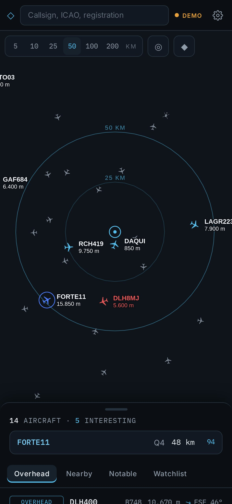
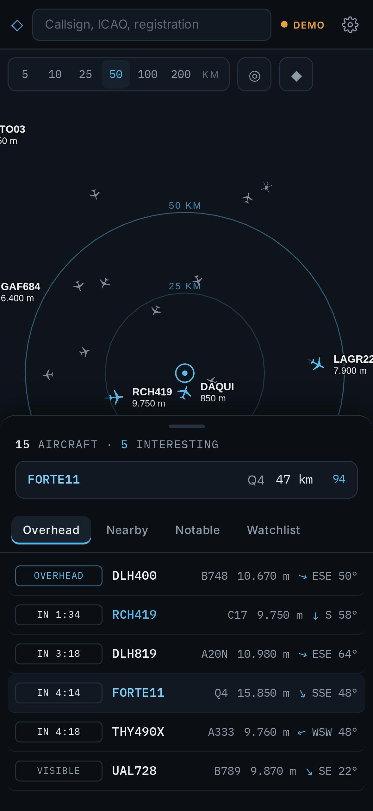
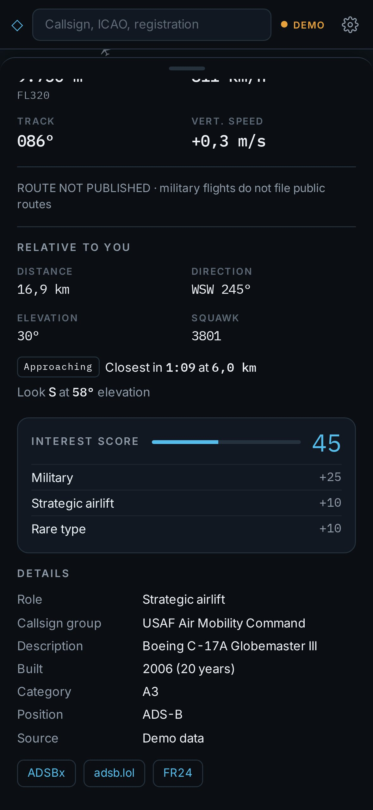

<div align="center">

# ◇ VectorScope

**Ein persönliches Live-Lagebild für iPhone und iPad.**

Eine Sammlung ruhiger, präziser Module unter einem Dach. Jedes beantwortet eine Frage zu dem, was um dich herum passiert, in einer gemeinsamen Designsprache: tiefes Graphit, Ice Blue, Farbe nur dort, wo sie etwas bedeutet.

<h3><a href="https://vectorscope.dobner.pro/">vectorscope.dobner.pro</a></h3>

[**▶ VectorScope öffnen**](https://vectorscope.dobner.pro/) · [English](README.md) · [Dokumentation](docs/de/README.md) · [Changelog](CHANGELOG.de.md)

[](https://github.com/michaeldobner/VectorScope/actions/workflows/tests.yml)
[](https://github.com/michaeldobner/VectorScope/actions/workflows/e2e.yml)

&nbsp;&nbsp;
&nbsp;&nbsp;


</div>

## Module

| Modul | Frage | Status | Version |
|---|---|---|---|
| [**AIR**](air/README.de.md) · Airspace | Was fliegt gerade über mir, was kommt als nächstes, was ist einen Blick wert? | Live · [öffnen](https://vectorscope.dobner.pro/air/) | 0.5.1 |
| [**INTEL**](intel/README.de.md) · Intelligence feed | Was melden geprüfte OSINT-Quellen und Fachmedien, und welches Flugzeug in der Luft betrifft es? | Live · [öffnen](https://vectorscope.dobner.pro/intel/) | 0.15.2 |
| [**NEWS**](news/README.de.md) · News | Was ist heute wichtig, und wie sieht es die Welt? | Live · eigener Server | 0.2.3 |

## Warum VectorScope

Flugtracker und Nachrichten-Apps zeigen alles, bunt und mit Werbung. VectorScope macht das Gegenteil: Jedes Modul beantwortet eine Frage sehr gut, und alle Module sehen gleich aus und verhalten sich gleich. Keine Werbung, kein Konto, kein Tracking. Alles läuft als Web-App auf dem eigenen Server, persönliche Daten bleiben auf deinem Gerät.

## Installation auf iPhone oder iPad

1. **https://vectorscope.dobner.pro/** in **Safari** öffnen.
2. **Teilen** antippen, dann **Zum Home-Bildschirm**.
3. VectorScope vom Home-Bildschirm aus öffnen und ein Modul wählen.

Um ein Modul direkt zu öffnen, seine eigene Adresse zum Home-Bildschirm hinzufügen: **https://vectorscope.dobner.pro/air/** oder **https://vectorscope.dobner.pro/intel/**. Safari und die installierte App haben getrennte Speicher, den Standort deshalb in der installierten App festlegen.

## Aufbau des Repositorys

```
VectorScope/
├─ index.html              Startseite: Liste der Module
├─ modules.json            Modulverzeichnis, maßgebliche Quelle für Versionen
├─ shared/                 gemeinsame Hülle: Tokens, Stile der Startseite, Icons, Schriften
├─ air/                    Modul AIR: Live-Luftlagebild
├─ intel/                  Modul INTEL: geprüfter OSINT-Feed mit Live-Abgleich
├─ news/                  Modul NEWS: Nachrichten-App aus geprüften Feeds, Geschichten mit allen Perspektiven
├─ proxy/                  CORS-Proxy auf Vercel, für alle Module
├─ lab/                    Test-Labor mit echtem Internet
├─ scripts/                Build, lokaler Server, Rauchtest, Release
├─ tests/                  Prüfungen des Repositorys
├─ docs/                   Dokumentation der Sammlung (en, de)
└─ .github/workflows/      Tests, E2E, Deploy, Labor
```

Einzelheiten: [Architektur](docs/de/architektur.md).

## Dokumentation

| Dokument | Inhalt |
|---|---|
| [Architektur](docs/de/architektur.md) | Aufbau des Repositorys, Modulverzeichnis, gemeinsame Hülle, Build, Service Worker |
| [Entwicklung](docs/de/entwicklung.md) | Einrichtung, Skripte, Prüfungen, Rauchtest, Test-Labor, Releases, Modul hinzufügen |
| [Deployment](docs/de/deployment.md) | Eigener Server, GitHub Pages stillgelegt, CORS-Proxy auf Vercel, Fehlerbehebung |
| [Roadmap](docs/de/roadmap.md) | Nächste Schritte, Ideen mit Serverbedarf, zurückgestellte Ideen |
| [Modul AIR](air/docs/de/README.md) | Bedienung, Berechnungen, Datenquellen, Design, Architektur |
| [Modul INTEL](intel/docs/de/README.md) | Bedienung, Quellen, Abgleich, Architektur |
| [Modul NEWS](news/docs/de/README.md) | Bedienung, Quellen, Geschichten und Wichtigkeit, Architektur, Datenschutz |
| [Gemeinsame Hülle](shared/README.de.md) | Tokens und Startseite |

## Schnellstart für Entwickler

```bash
npm install
npm run dev        # Modul AIR unter http://localhost:5173/
npm run dev:intel  # Modul INTEL unter http://localhost:5173/
npm run dev:news   # Modul NEWS unter http://localhost:5173/
npm test           # Unit-Tests aller Module und Prüfungen des Repositorys
npm run build      # Startseite und alle Module nach dist/
npm run preview    # dist/ wie der Server unter http://localhost:4173/
```

Jeder Push auf `main` wird getestet, der eigene Server rollt ihn mit Coolify aus.

## Daten und Quellen

Verkehrsdaten © Mitwirkende von [adsb.lol](https://adsb.lol), lizenziert unter ODbL 1.0. Routen und Flugzeugdaten von [adsbdb](https://www.adsbdb.com) und [hexdb.io](https://hexdb.io). Karte © [OpenFreeMap](https://openfreemap.org), © OpenMapTiles, © OpenStreetMap-Mitwirkende. Flugzeugfotos © die Fotografinnen und Fotografen von [planespotters.net](https://www.planespotters.net). Überschriften und Auszüge in INTEL © ihre Herausgeber, mit Link zum Original. VectorScope ist ein persönliches, nichtkommerzielles Projekt und steht in keiner Verbindung zu diesen Diensten.

## Version

Aktuelle Version: **0.22.9**. Siehe [Changelog](CHANGELOG.de.md).

Erstellt von Michael Dobner. Lizenziert unter der [MIT-Lizenz](LICENSE).
