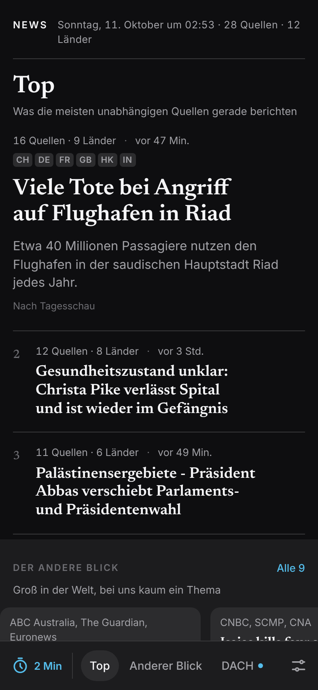
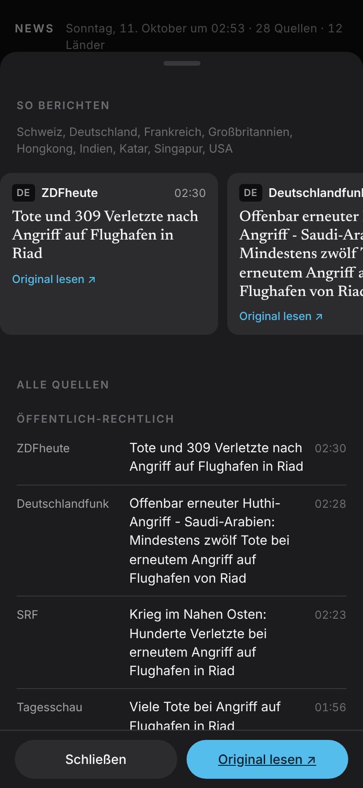
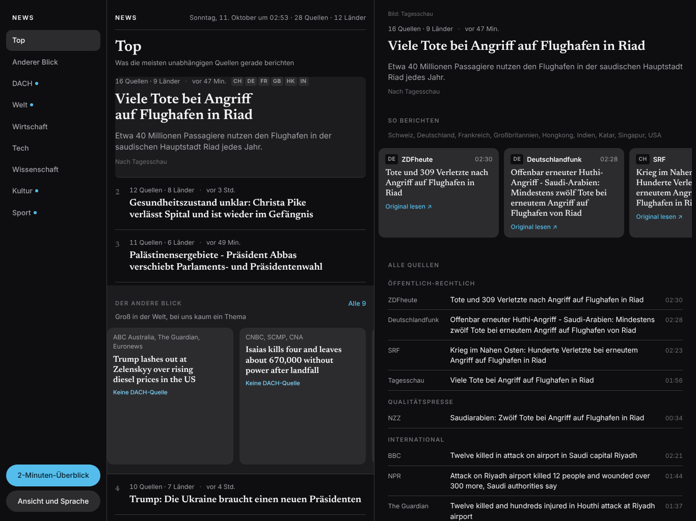

# ◇ VectorScope News

**The news of the day from 42 feeds in 13 countries, as stories with every perspective.** Module NEWS of the [VectorScope collection](../README.md).

[Deutsch](README.de.md) · [Documentation](docs/en/README.md) · [Changelog](CHANGELOG.md) · [Concept (German)](KONZEPT.md)

&nbsp;&nbsp;
&nbsp;&nbsp;

## Why NEWS

Every news app shows the world from the view of its own newsroom, plus ads. NEWS reads Tagesschau, SRF, ORF, NZZ, Spiegel, ntv, BBC, Guardian, Al Jazeera, NPR, SCMP, Times of India and more, groups their reports into **stories** and shows side by side how each outlet headlines them. What matters is what many independent outlets from many countries report and what the leading newsrooms put first themselves. No ads, no account, no tracking, no AI texts.

## Highlights

| | |
|---|---|
| **Stories instead of articles** | One event appears once, with "19 sources · 10 countries". A multilingual model knows that "Zwölf Tote in Riad" and "Twelve killed in Riyadh" are the same story |
| **Perspectives** | How Tagesschau, NZZ, BBC and Al Jazeera headline the same story, side by side, each linked to the original |
| **The other view** | What moves the world but is missing in German-language media. With the global perspective the other way round: what only German-language media care about |
| **2-minute briefing** | The ten most important stories, one per screen, with an end |
| **Three settings** | App language German or English, reports in German, English or the original, perspective German-speaking, Belgium or global. The first start follows the language of the device |
| **Controls in the thumb zone** | Sections, briefing and settings at the bottom. Nothing to tap below the camera |
| **iPhone and iPad** | Three columns on the iPad in landscape, two in portrait |

## Install

NEWS runs on the own server, which also collects the news. Open its address with `/news/` in Safari, tap **Share**, then **Add to Home Screen**.

## Documentation

| Document | Content |
|---|---|
| [User guide](docs/en/user-guide.md) | Views, sections, stories, perspectives, 2-minute briefing, settings, what is new |
| [Sources](docs/en/sources.md) | The 42 feeds, groups and weights, the check in the lab, rejected candidates |
| [Stories and importance](docs/en/stories.md) | Grouping by meaning, sections, the three signals, texts, pictures, translation |
| [Architecture](docs/en/architecture.md) | Collector on the server, one round, format of the edition, app, tests |
| [Privacy and legal](docs/en/privacy-and-legal.md) | Requests, storage, third party content, licences |
| [Concept](KONZEPT.md) (German) | The decisions of the editor in chief and the inventor |

## Version

Current version: **0.3.3**. All changes in the [changelog](CHANGELOG.md).

Headlines, teasers and pictures © their publishers, each linked to the original.
